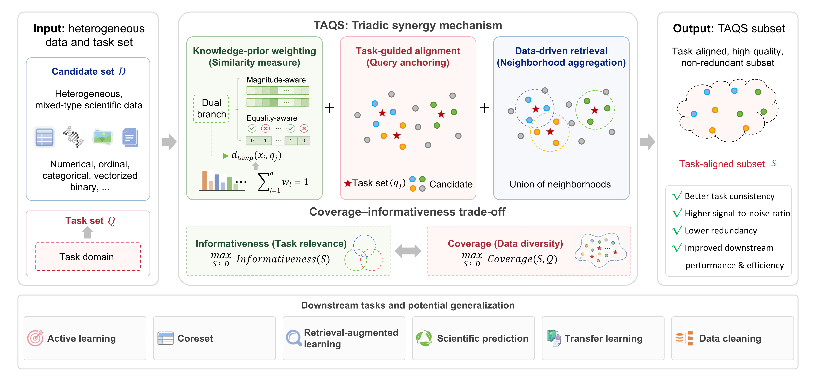

# Task-Aware Query-Anchored Selection (TAQS)



## Overview

This repository contains the implementation of **Task-Aware Query-Anchored Selection (TAQS)**, a novel data selection framework that leverages task-aware weighted distance metrics to identify the most relevant training samples for target tasks. TAQS improves data efficiency and model performance by strategically selecting subsets that maximize task alignment while minimizing distributional shift.

## Key Features

- **Task-Aware Weighted Gower Distance (TAWG)**: A customized distance metric that incorporates feature importance weights for mixed-type data (numerical and categorical features)
- **Query-Anchored Selection**: TAQS adopts a query anchoring mechanism, using the task set as a reference and achieving task-domain alignment through local neighborhood coverage
- **Comprehensive Validation Framework**: Includes comparative experiments, ablation studies, running time and scalability experiments
- **Interactive Web Demo**: A browser-based Flask/static demonstration for hands-on data selection on your own or bundled datasets

## Repository Structure

```
TAQS/
├── configs/                       # Configuration files
│   ├── datasets_config.yaml           # Dataset specifications
│   └── plot.yaml                      # Visualization settings
├── data/                          # Data directory
│   ├── demo/                      # Demo dataset for the interactive web app
│   ├── feature_weights/           # Feature weights for high-dimensional datasets
│   ├── raw/                       # Original datasets (not tracked)
│   └── processed/                 # Preprocessed datasets used in experiments
├── src/                           # Source code
│   ├── taqs_algorithm.py              # Core TAQS implementation
│   ├── data_processor.py
│   ├── baselines.py                   # Baseline methods (Random, K-Medoids, etc.)
│   ├── utils.py
│   ├── calculate_feature_importance.py    # Feature-importance / weight computation
│   ├── comparative_experiment.py      # Main comparative experiment pipeline of TAWG
│   ├── validation_taqs_paradigm.py    # Main experiment pipeline of TAQS
│   ├── validation_taqs_paradigm_vs_others.py
│   ├── tune_mlp_params.py             # MLP hyper-parameter tuning
│   ├── convergence_analysis_taqs_*.py # Convergence analysis per predictor (MLP / RF / RR)
│   ├── noise_impact_experiment.py     # Robustness under injected noise
│   ├── information_leakage_experiment.py  # Information-leakage control study
│   ├── performance_distance_relationship.py  # Performance vs. task-distance analysis
│   ├── taqs_runtime_scalability_experiment.py  # Runtime scaling with n, m, d
│   ├── taqs_task_domain_shift_analysis.py      # Task-domain shift analysis
│   ├── disjoint_task_evaluation_experiment.py  # Disjoint task evaluation
│   ├── practical workflow.py          # End-to-end practical workflow
│   └── other/                     # Additional analysis & plotting scripts
├── results/                       # Experimental results
├── app.py                         # Flask backend for the interactive web demo
├── taqs_demo.html                 # Static (frontend-only) web demo
├── taqs_demo_flask.html           # Web demo UI served by app.py
├── TAQS_logo.png                  # Project logo
├── TAQS_supplementary_materials.pdf   # Supplementary materials
└── requirements.txt               # Python dependencies
```

## Installation

### Prerequisites

- Python 3.8 or higher
- pip package manager

### Setup

1. Clone this repository:
```bash
git clone https://github.com/StarJmx/TAQS.git
cd TAQS
```

2. Create a virtual environment (recommended):
```bash
python -m venv venv
source venv/bin/activate
```

3. Install dependencies:
```bash
pip install -r requirements.txt
```

## Interactive Web Demo

A browser-based demonstration of TAQS is included for hands-on exploration of data selection.

### Running with the Flask backend

1. Install dependencies (Flask is listed in `requirements.txt`).
2. Start the server:
```bash
python app.py
```
3. Open [http://localhost:5000](http://localhost:5000) in your browser.

> The Flask-served page (`taqs_demo_flask.html`) requires the backend to be running. Always start `app.py` first, then open the URL.

You can upload your own Task and Train CSV files, or click **Load demo data** to run TAQS on the bundled pain-prediction demo dataset (`data/demo/`).

### Static demo

A frontend-only version is also available: open `taqs_demo.html` directly in a browser (no backend required).

## Data Availability

The datasets used in this work are collected from publicly available sources.
Preprocessed datasets used in the experiments are included in `data/processed/`.
Original datasets can be obtained from their respective public repositories.

## License

This code is provided for academic research and reproducibility purposes. Full licensing terms will be provided upon publication.

---

**Status**: This work has been submitted for peer review (single-blind). The repository is no longer anonymized. Please cite the paper if you use this code. Complete metadata and documentation will be finalized upon acceptance.

## Citation

If you find this work useful, please cite our paper:

```
@article{jiang2026taqs,
  title   = {TAQS: Task-Aware Query-Anchored Data Selection for Scientific Machine Learning},
  author  = {Jiang, Mingxing and Yin, Xiang and Chen, Yuqiong and Lin, Sijie},
  year    = {2026},
  note    = {Submitted to VLDB 2027},
}
```

> Mingxing Jiang, Xiang Yin, Yuqiong Chen, and Sijie Lin. 2026. TAQS: Task-Aware Query-Anchored Data Selection for Scientific Machine Learning. (Submitted to VLDB 2027).
